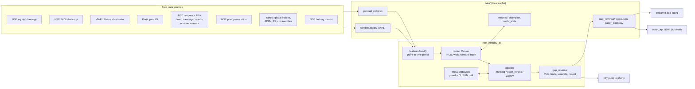

# NSE Gap-Reversal Book — Architecture

Developer: Shine · Package: `src/nse_intraday_ai` · Python ≥ 3.11

## 1. What the system does

Each NSE trading day it publishes a list of **8 stocks to short intraday**:
the liquid names most likely to give back yesterday's overnight gap-up. Ranker lists
enter at the open (pre-open market order). Lists ranked by the gap rule enter with a
**pre-open SELL LIMIT** at `prev_close × (1 − 0.75%)`, rounded up to the tick
(unfilled orders are cancelled at 09:15; `GapReversalConfig.entry_limit_for`). The stop is a buy-stop at entry + 0.75 × the 14-day ATR,
and the position is covered at 15:15. A gradient-boosted **ranker** orders the candidates.
It is promoted only on walk-forward evidence and guarded by a live paired record against the plain gap rule.
A paper book records every session from official NSE bars, and the system learns from it every day.

## 2. High-level architecture



## 3. Modules

| Module | Role |
|---|---|
| `nse_bhav`, `nse_fo`, `nse_extra`, `nse_flows` | Download and cache NSE daily files: equity bhavcopy (incl. delivery %), F&O bhavcopy, MWPL/ban/short-sale files, and participant-wise OI. Holidays are cached as `.holiday` markers. |
| `nse_corp` | NSE corporate APIs (board meetings, financial results, Integrated Filing, announcements) with monthly parquet caches and manifests. Provides point-in-time catalyst features (`corp_features`). |
| `nse_preopen` | Fetches and archives the pre-open call-auction snapshot. Encodes the auction timing regimes (09:08 before 2026-09-07, then a random close in 09:08–09:10). A snapshot is final once the clock passes 09:12. Per-stock stamps show the moment entry closed, so they can't prove finality on their own (the old stamp ≥ 09:10 test kept the archive empty until 2026-10-06). `archived_opens(day)` gives the official opens: 1,980 of 1,980 equal the bhavcopy open on 2026-10-06. |
| `nse_calendar` | NSE trading holidays: the holiday-master API (7-day cache) plus bhav markers. |
| `nse_bands` | Daily price bands (circuit limits) and series from NSE `sec_list.csv`, archived by download date under `data/nse_bands/`. `etf_symbols()` names the ETFs (which trade in EQ) that `features.build` drops from the universe. `untradeable_reason()` flags shorts whose stop is not at least 0.5 pt inside the band or whose series is no longer EQ (not MIS-shortable); `gap_reversal.drop_untradeable()` removes them and promotes reserves (free in walk-forward: −0.2 bps/slot, t −0.5). |
| `auth` | Dashboard password: salted PBKDF2-SHA256 hash in the git-ignored `data/auth.json` (mode 600). Set with `python -m nse_intraday_ai.auth --set-password`. |
| `candle_cache` | SQLite (WAL) cache of Yahoo daily/5-minute candles: global series, the fallback path, and replay. |
| `features` | `load_inputs()` → `build()`: one row per (session, symbol), every feature dated strictly before the decision time, ±inf → NaN. It defines the feature groups `OPEN_FEATURES`, `PREOPEN_FEATURES`, `CORP_FEATURES` and the gate `UNVALIDATED_FEATURES`. |
| `ranker` | `Ranker` (sklearn HistGB by default; LightGBM regression/LambdaRank optional) with `walk_forward()`, `book()`, `summarize()`, `paired()`. Also the selection-bias controls `deflated_sharpe()` and `holm()`, plus champion persistence. `fit` records each feature's usual blank rate; `missing_inputs()` flags features that are blank for every candidate today (a data source is down). The flag is shown in the 08:15 push and in the health check. |
| `meta` | `MetaState`: a paired per-expert daily record (*guard*: trade the ranker unless it is worse than the rule at t < −2 over 60 sessions), a CUSUM drift alarm with cautious mode, and diagnostic Hedge weights. |
| `pipeline` | `morning()` (08:15 list), `open_rerank()` (09:10:30, archives the auction and re-ranks if an open model is promoted), `learn_through()`/`learn_from()` (grade every unlearned session) and `weekly()` (retrain, walk-forward, promote on evidence). |
| `gap_reversal` | The book itself: `GapReversalConfig`, `Pick`, tick-size and entry-limit rules, the rule ranker, daily and 5-minute simulators, the picks file, and the paper record. It also holds the Yahoo fallback path. |
| `costs` | Groww/NSE MIS round-trip cost model (brokerage, STT, exchange, SEBI, stamp, GST, slippage). |
| `alerts` | ntfy push (topic from `NTFY_TOPIC` or the git-ignored `data/notify.json`); Telegram is optional. |
| `atomic_io` | Atomic JSON writes and retrying reads, shared by every state file. |
| `cloud_sync` | Pushes the list, paper book, model summaries (`state_files()`) and the live scan to GitHub `main` for the Streamlit Cloud copy, via git plumbing in a throwaway index: the checked-out branch, its index and the working tree are never touched. A no-op inside GitHub Actions. |
| `intraday_monitor` | Live NIFTY-500 monitor (information only). `load_day` keeps completed 5-minute bars only; `snapshot` gives move, gap, relative volume vs a 20-session cumulative profile, breadth, highs/lows and near-circuit names. Paper strategies `orb60`, `gap_fade`, `vol_breakout` are pure functions graded at 13.3 bps (`grade`, `record_day`, `board_stats` with Holm). `gap_book_watch`/`gap_alerts` watch today's gap shorts against their stops. Writes `data/intraday/live.json`. |
| `app`, `gap_reversal_ui`, `intraday_ui` | Streamlit dashboard "NSE Trading Desk": Gap book — Today, Intraday monitor, Performance, Model, About. Plotly charts with zoom, a unified-hover data cursor, units and CSV export. |

Scripts (`scripts/`):

| Script | Role |
|---|---|
| `gap_reversal.py` | Subcommands `picks`, `final`, `levels`, `record`, `backtest`. |
| `learn.py` | The weekly or conditional retrain. |
| `health_check.py` | Checks units, app, memory, disk, data freshness, the book, sessions the learner never graded, sessions with no published list, blank model inputs, and the pre-open archive (growing, and equal to the official opens). |
| `daily_monitor.py` | Live-versus-expected report and phone summary. Expert means cover live sessions only; the guard's walk-forward seeds are reported separately. |
| `compare_rankers.py` | Production-faithful walk-forward A/B with Holm and DSR. |
| `backfill_nse.py`, `backfill_corp.py` | History backfills. |
| `ticket_api.py` | JSON API for the Android app. |
| `intraday_monitor.py` | Subcommands `scan [--push] [--force]` (live NIFTY-500 + indices + gap-book watch), `replay --date`, `board` (shadow-board stats), `catchup` (grade shadow-board sessions missed while the machine was off). |

## 4. Daily data flow and schedule (systemd user timers, IST)

| Time | Unit | What happens |
|---|---|---|
| 08:15 Mon–Fri | `nse-gap-picks` | Holiday check, then `refresh()` the NSE files, corporate events and global closes. `learn_through(previous session)` grades every session not yet learned (a day the laptop was off included) and updates the guard and CUSUM. Features are built for today and ranked by the guarded expert. Shorts whose stop lies beyond the price band are dropped (reserves move up). Limits are attached and `picks.json` is written, with a dated copy in `gap_reversal/history/` (what `record` grades). Push, and `cloud_sync` it to GitHub. |
| 09:10:30 | `nse-gap-final` | Fetch and archive the pre-open auction. If a promoted open model passes its guard, re-rank and push the final list. Otherwise the 08:15 list stands. |
| 09:18 | `nse-gap-levels` | Push stop prices from the official opens (the archived auction; the first 5-minute bar only if no archive exists). Names that opened below their limit are marked NOT FILLED. |
| every minute 09:20–15:45 (completed 5-minute bars) | `nse-intraday-scan` | `intraday_monitor.py scan --push`: Yahoo 5-minute bars for NIFTY-500, today's gap shorts and NIFTY 50 / NIFTY BANK / India VIX → `data/intraday/live.json` (snapshot, breadth through the day, sector board). Phone alert (deduplicated per day in `alerts_YYYYMMDD.json`) only when a gap-book short hits or comes within 1% of its stop. After 15:15 the day's paper shadow-board trades are appended to `shadow_book.csv`; the first scan of a day grades any session missed while the machine was off (`board_sessions.json`, once per day per session). |
| 15:40 | `nse-gap-record` | Record the session's *published* list in `paper_book.csv`. Entry is the official open (the archived auction, else NSE's bhavcopy), then the 5-minute path (`NO_FILL` rows for unfilled limits). A finished session whose bars stop before 15:15 for most picks is not recorded; it is retried on the next run. `nse-gap-monitor` (16:05) and `nse-health` are ordered after it, so a boot-time catch-up reports on fresh data. |
| 19:00 daily | `nse-gap-learn` | `learn.py --if-needed` retrains on Saturdays, on a drift alarm, or when the last review is 7+ days old (a Saturday the laptop was off no longer skips the week). It runs `weekly()`: walk-forward over the last 2 years with quarterly refits, and promotes each model only if it beats its reference with paired t ≥ 2 and a positive edge. |
| every 30 min | `nse-health` | `health_check.py`: failures exit 1, warnings exit 0. |
| always | `nse-signal-lab` | Streamlit on :8501. |

Timers use `Persistent=true` (except the time-bound 09:10 final, 09:18 levels and the intraday scan), so a job missed while the laptop was asleep runs at wake-up. The 08:15 list prints a LATE banner after 09:08. At boot or resume every job first waits for NTP and then for DNS (`wait_for_clock`/`wait_for_network`). The hardware clock has come up wrong (5.5 h fast on 2026-09-29, *June 5* on 2026-10-27), and on resume the Wi-Fi is not back when the timers fire.

**Cloud copy (Streamlit Cloud, branch `main`).** `main` carries the code (merged from `devel`) plus small data files that `cloud_sync` mirrors from the laptop: `picks.json` (08:15 list, 09:10 final, 09:18 levels), `paper_book.csv` (15:40), `backtest.json`, the model summaries `champion.json` / `weekly_report.json` / `meta_state.json` (learn), and `live.json` + `shadow_book.csv` (every 5 minutes during the scan). Model binaries and raw market data are never published (the repo is public). The cloud app logs in with the `DASHBOARD_PASSWORD` Streamlit secret and fails closed without it. When the newest scan is from an earlier session, the intraday page says so and shows no stop alerts.

**Laptop off (all times IST).** `.github/workflows/gap_picks.yml` runs `scripts/gap_reversal.py cloud-fallback --push`. It builds the gap-rule list at 08:00, polls `main` until 08:20, and publishes only if neither the laptop nor an earlier run has published today's list. It then pushes to the phone, so the list is out by about 08:21. Because GitHub starts scheduled runs late (about 15 min here) and can drop them, the main run is scheduled at 03:00 and waits. Runs at 07:47 and 08:07 are back-ups, and a concurrency group lets only one run at a time. The publish uses a guard evaluated on the exact commit it builds on, so a fallback list can never land on top of a laptop list. When the laptop publishes after a fallback list, its phone message says it replaces it. A manual run from the Actions tab is a dry run unless `mode: publish` is chosen. With an `NTFY_TOPIC` repository secret the fallback also reaches the phone. `picks.json` records which `publisher` built it. (Workflow files need a token with the `workflow` scope.)

**Intraday shadow board.** The 2026-10 search (≈100 published intraday variants, `docs/research-log.md`) found none that survives costs. The three closest are run as a paper board only, labelled NOT VALIDATED, and never pushed as trades. A strategy becomes "eligible for review" only after ≥ 60 live sessions with a positive mean net of costs and Holm-adjusted p < 0.05; any promotion still needs a walk-forward study.

## 5. Threading and process model

- Every scheduled job is a **separate short-lived process** (systemd oneshot); there are no long-running daemons apart from Streamlit and the optional ticket API.
- Downloads use small thread pools (`backfill(..., workers=2)`) and are rate-limited for NSE.
- Model training uses the libraries' native threads (sklearn HGB OpenMP / LightGBM `n_jobs=-1`). Heavy research jobs run under `systemd-run --user` with `Nice` and `MemoryMax` so they survive agent restarts and cannot starve the live jobs.
- Concurrency safety: JSON state uses atomic replace (`atomic_io`), SQLite runs in WAL mode, and parquet files are written once per day or month.

## 6. IPC and interfaces

- **Phone**: ntfy HTTPS push. The topic is secret-by-obscurity, so use a random one (`alerts.py --set-ntfy-topic`).
- **Android app**: polls `ticket_api.py` (`/tickets`, `/record`, `/portfolio`, `/health`) on the LAN. It has no authentication, so run it only on a trusted network.
- **Dashboard**: Streamlit on :8501 with XSRF protection on and a password login (`auth`; fails closed when no password is set, back-off after wrong attempts). Bind it to localhost or a firewalled LAN.
- No inter-process sockets otherwise: the processes share state through the files under `data/`.

## 7. Learning loop and safeguards

1. **Daily**: every expert's own top-8 is graded on the official outcome. That extends a paired record, and the *guard* uses it to choose which expert's list is traded. The CUSUM on the live book versus the walk-forward expectation raises a drift alarm and cautious mode (60% size) when the shortfall persists.
2. **Weekly**: a full point-in-time rebuild and walk-forward. Challengers are promoted only on out-of-sample evidence; the previous champion stays otherwise.
3. **Research gate**: new features are built but kept out of the live models (`UNVALIDATED_FEATURES`) until `compare_rankers.py` shows paired t ≥ 3 after a Holm correction. Deflated Sharpe charges for every trial so far (`docs/research-log.md`).

## 8. Directory layout

```
src/nse_intraday_ai/   package (22 modules)
scripts/               CLIs run by systemd and by hand
tests/                 pytest suite (unit + app smoke + script smoke)
deploy/                install.sh + systemd units/timers
android/               companion app (polls ticket_api)
docs/                  ARCHITECTURE.md (this), research-log.md
data/                  local caches and state (git-ignored except the universe CSV)
data/archive/          compressed archives of retired components' state
```
